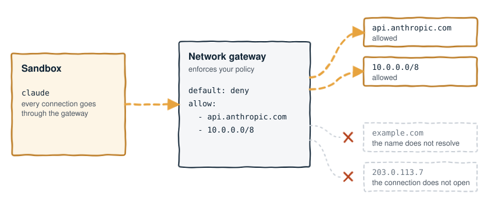

# Networking and egress policy

You control what a sandbox reaches in two ways. A network posture sets which
network the sandbox is on. An egress policy sets what the agent can reach
outbound, and you bind it to a profile or to one session.

## Quick example

A complete policy:

```yaml
apiVersion: brig.sh/v1alpha1
kind: Policy
metadata:
  name: locked-down
  description: only Anthropic's API and one internal range
spec:
  egress:
    default: deny
    allow:
      - host: api.anthropic.com
      - cidr: 10.0.0.0/8
```

<p align="center">
  
</p>

Brig enforces a policy on Linux with nerdctl, and on macOS with the `hvi`
backend. It refuses a policy-bound run anywhere else. See
[Where a policy is enforced](#where-a-policy-is-enforced-and-where-it-is-not).

Create the policy, attach it to a profile, and check it:

```bash
brig policy create locked-down   # writes ~/.config/brig/policies/locked-down.yaml
brig policy attach locked-down claude-code
brig policy check claude-code
```

`brig policy create` writes a starter document and opens it in your editor.
Fill it in as shown above. `brig policy check` names each policy bound to
the profile, and says where Brig can enforce it:

```
locked-down
note: enforced on the hvi backend and on Linux with nerdctl, which give the sandbox a network of its own; a run on any other backend is refused rather than left unenforced
```

Then run the agent as usual, with `brig run claude`. A sandbox that is
already running restarts to take the policy.

To remove the policy from the profile again:

```bash
brig policy detach locked-down claude-code
```

## Network postures

Every sandbox runs under one of three postures:

| posture | what it permits |
| --- | --- |
| `shared` | one network for every sandbox using this posture on the host. Opt-in, except for the `vz` profiles and retained older sessions |
| `isolated` | a network of this sandbox's own. The default for new `hvi` and nerdctl sandboxes |
| `offline` | no route out. The agent runs, the guest home is mounted, nothing leaves |

```bash
brig run claude                         # a new sandbox gets its own network
brig run --network shared claude@shared # explicitly share one with other sandboxes
```

Both `shared` and `isolated` permit internet access. Isolation separates
sandboxes. It applies no outbound allow list, and it does not promise that
host services are unreachable. An egress policy is a separate choice.

Sandboxes on `shared` reach each other on `hvi` and on Linux. `vz` is not
measured on a current hull. `--network isolated` keeps a sandbox off that
network. The measurements for each backend are in
[Things Brig does not claim](security.md#things-brig-does-not-claim).

### Set a posture

Brig uses the first posture that it finds in this order:

1. The `--network` flag.
2. The `BRIG_NETWORK` setting.
3. The posture that the sandbox was started with.
4. The `network:` field of the profile.
5. The default for the backend.

Brig refuses a run with an unrecognized value, and names where the value
came from:

```console
$ BRIG_NETWORK=bogus brig info claude-code
brig: BRIG_NETWORK "bogus" is not a posture: use shared, isolated or offline
```

### Posture by backend and profile

On macOS, `isolated` needs the `hvi` backend. On Linux it needs nerdctl: hull on Linux cannot give a sandbox its own network yet.

| Case | Posture |
| --- | --- |
| A new sandbox on `hvi`, or on Linux with nerdctl | `isolated` |
| The seven built-in `hvi` profiles | `isolated`. Each profile names that posture |
| `claude-desktop` | `shared`. The profile names that posture, because its GUI requires `vz`, where Brig cannot give a sandbox its own network |
| The unpublished `cursor` profile | The profile names no posture. It gets `isolated` on nerdctl and `hvi`, and the `shared` fallback on `vz`, `qemu` and hull on Linux |
| A custom profile with no `network:` field, on `vz`, `qemu` or hull on Linux | `shared`, only when no flag, environment setting or retained posture names a network. The `NETWORK` row in `brig info` names that backend fallback |
| An explicit `isolated`, such as `--network isolated`, on `vz`, `qemu` or hull on Linux | Refused |
| A built-in `hvi` profile overridden to `vz` or `qemu`, or run on hull on Linux | Needs `--network shared` or `BRIG_NETWORK=shared`, because the profile asks for isolation |

On `hvi`, the network of each isolated sandbox used about 28.7 MB of memory
in the measurement recorded in
[#369](https://github.com/brig-sh/brig/issues/369). The pool of isolated
networks holds 64, and Brig refuses another boot when it is empty.
`brig rm <ref>` frees the network of an unused sandbox. Linux does not use
this pool.

### Read the posture

`brig info` prints the posture as one of these three lines:

```
NETWORK      shared (one network for every sandbox on this host)
NETWORK      isolated (a network of this sandbox's own)
NETWORK      offline (no egress)
```

The row names the posture of the running sandbox. When the next boot gets a
different posture, for example after you attach or detach a policy, the row
names that posture too:

```
NETWORK      isolated (a network of this sandbox's own); shared from its next boot
```

### Change the posture

A sandbox keeps the posture that it was started with. A later command that
names no posture, such as `brig sh`, `brig info` or a bare `brig run`, uses
that posture. The `network:` field of the profile does not change it.

To change the posture, name a different one with `--network` or
`BRIG_NETWORK`. Brig restarts the sandbox, and says which posture it leaves
and which posture it goes to:

```console
$ brig run claude --network shared
brig: this sandbox was started with the isolated posture and --network asks for shared
  ↳ rules are fixed when a sandbox boots, so brig restarts it
  ↳ any other session using this sandbox will be disconnected
```

### Postures and policies

An egress policy bound to a sandbox forces the `isolated` posture, whether
or not `--network` asked for it. An `offline` run stays `offline`. Brig
keeps a record of the posture that you asked for, and the sandbox goes back
to it after you detach the policy. Until the next boot, `brig info` names
`isolated`, the posture that the sandbox runs with.

To keep `isolated` after a detach, ask for it with `--network isolated`
while the policy is attached. Brig restarts the sandbox to record that
posture.

<details>
<summary>Sessions with no posture record, and other rare cases</summary>

A session from an older release can have no posture record. Brig then reads
the posture from the runtime, and a run that reuses the sandbox records it.

When Brig cannot establish the posture, `brig info` reports it as unknown,
and Brig refuses a run that names no posture. Name the posture with
`--network` or `BRIG_NETWORK` to recreate the sandbox. That disconnects any
session that uses it. If you removed the VM with `hull rm`, `brig ls` prunes
the stale session, and `brig rm <ref>` forgets it.

If you changed `BRIG_GATEWAY_DIR` or `BRIG_GATEWAY_SOCK` since the sandbox
booted, Brig cannot find its network records. Restore the settings, or name
`--network`. Brig rejects a `BRIG_GATEWAY_SOCK` override named
`sandbox-*.sock`, because isolated gateways use that name. Older releases
allowed a shared override with that name, and Brig can report a sandbox
started that way as `isolated` when it is shared.

An older release that boots the sandbox again does not update the record,
so `brig info` can name a posture that the sandbox no longer has. A
`brig stop` and a `brig run` from the current release write a new one.

</details>

## Write a policy

A policy is a named YAML (or JSON) document that declares what an agent can
reach outbound. It sets a default of `allow` or `deny`, and `host` or `cidr`
exceptions on either side. `brig policy create` writes a starter and opens
it in your editor, the same way `brig agent edit` does:

```bash
brig policy create locked-down   # writes ~/.config/brig/policies/locked-down.yaml
brig policy edit locked-down     # change the rules
```

## Where policies live

Brig keeps one file for each policy in a flat directory, for example
`~/.config/brig/policies/locked-down.yaml`.

| Setting | Policy directory |
| --- | --- |
| default | `~/.config/brig/policies` |
| `$XDG_CONFIG_HOME` | `$XDG_CONFIG_HOME/brig/policies` |
| `BRIG_POLICY_DIR` | the value as given, relative or not. It overrides the other two |

An empty or relative `$XDG_CONFIG_HOME` counts as unset, as the
[XDG Base Directory Specification, version 0.8](https://specifications.freedesktop.org/basedir/latest/)
requires.

The directory starts empty. Brig writes there only when you run `brig
policy create`, `edit`, `rm`, `attach` or `detach`.

`metadata.name:` inside the file wins over the filename, as it does for a
profile.

One file that fails to parse does not stop the other files from loading.
`brig policy ls` reports that file on stderr and lists every policy that did
load. It reports two files that declare the same name in the same way.

## Policy fields

The [quick example](#quick-example) shows a complete document. It uses the
Kubernetes envelope: `apiVersion`, `kind`, `metadata` and `spec`.

| field | required | what it is |
| --- | --- | --- |
| `apiVersion` | yes | Pins the document shape. `brig.sh/v1alpha1` is the only value this build knows. Anything else is refused |
| `kind` | yes | `Policy`. A document without `kind` is read as the retired flat form. See [The flat form](#the-flat-form) |
| `metadata.name` | yes | The policy's identifier. Wins over the filename, and follows the same character rule as a profile name. See [Naming a policy](#naming-a-policy) |
| `metadata.description` | no | One line, shown by `brig policy ls` |
| `metadata.labels`, `metadata.annotations` | no | Maps of strings. Brig does not read them |
| `spec.egress.default` | yes | `allow` or `deny`, applied to any traffic neither list below names |
| `spec.egress.allow` | no | Exceptions to a `deny` default |
| `spec.egress.deny` | no | A host or range to refuse regardless. Where the rules are enforced, `deny` takes priority over `allow` and over `default`. See [Where a policy is enforced](#where-a-policy-is-enforced-and-where-it-is-not) |

Each entry in `allow` or `deny` names one of `host:` or `cidr:`. Brig
refuses an entry that names both, and an entry that names neither.

| Key | Value | What Brig checks |
| --- | --- | --- |
| `host:` | a domain, or a glob such as `"*.githubusercontent.com"` | Brig refuses a host only for whitespace or a control character |
| `cidr:` | a network range such as `10.0.0.0/8` | Brig refuses a value that is not a valid range, such as `10.0.0/8` (an octet short) |

A `host:` glob matches the name that the guest looks up. `*` spans dots,
and `*.example.com` does not cover `example.com` itself.

Parsing is strict. A field that the format does not recognize fails to
parse, such as `engine:` under `spec` or a typo such as `descripton:`. A key
must match the field name byte for byte, so `Spec:`, or a key with a
lookalike letter such as `ſpec:`, is refused too. So is a block or a list
with no value, such as `allow:` with every rule under it commented out. Give
it a value, or leave the key out. A file holds one document, and Brig
refuses a second one after `---`.

### The flat form

Older policies leave out `kind` and put `name`, `desc` and `egress` at the
top level. Brig still reads that form until v0.6.0. A key in the flat form
matches its field without regard to case, as in `Egress:`. Brig refuses two
spellings of one key, such as `name:` and `Name:`.
`brig policy check` prints a notice for each bound policy that a file still
writes in the flat form. `brig policy show` prints any policy in the
envelope form.
[Policy documents](migration.md#policy-documents) has the mapping.

## Routes

A route is a brokered endpoint. The agent in the guest is pointed at the
route, and the broker forwards each request upstream with the credential
added on the host. The guest holds a session token for the route, never the
credential.
[broker.md](broker.md) describes how the broker handles each request.

> [!NOTE]
> A guest on `hvi` or on Linux with nerdctl reaches a route at
> `https://brig.internal`, with the brig CA (see
> [Transports](broker.md#transports)). On hull on `vz` or `qemu`, and on
> docker, Brig refuses a run bound to a policy with routes before anything
> boots, with exit `7`:
>
> ```
> brig: policy claude-only (route anthropic) declares a route in mode endpoint, which the guest reaches at brig.internal: a policy applies to this sandbox, and hull on vz cannot enforce the route mode endpoint: vz takes its network from vmnet, and brig routes brig.internal at the user-mode network gateway that only the hvi backend uses. Run it on hvi (BRIG_HYPERVISOR=hvi), or detach the policy. brig will not boot a sandbox under a policy nothing enforces
> ```
>
> [Use it](broker.md#use-it) walks through a first run.

A policy with one route:

```yaml
apiVersion: brig.sh/v1alpha1
kind: Policy
metadata:
  name: claude-only
  description: Claude Code through the broker; no other egress
spec:
  egress:
    default: deny
  routes:
    - name: anthropic
      preset: claude-code
      credential:
        secretRef: { name: claude-credentials }
```

A policy needs `spec.egress`, `spec.routes`, or both.

### Route fields

| field | required | what it is |
| --- | --- | --- |
| `name` | yes | The path segment of the route URL, and unique across the policies bound to a run. Lowercase letters, digits and dashes, starting with a letter: the name also names the guest variable `BRIG_ROUTE_<NAME>_TOKEN`, with `-` read as `_`, so Brig refuses a dot and an underscore |
| `preset` | no | A route type that Brig ships. See [Presets](#presets) |
| `mode` | no | `endpoint`, the default: the tool is pointed at the route URL. This build of Brig refuses a route in any other mode before boot. See [Route modes](broker.md#route-modes) |
| `upstream` | unless a preset sets it | A bare `https://` origin in canonical form, such as `https://api.example.com:8443`. Brig refuses a path (a lone `/` too), a query, a fragment, a user name, upper case, a wildcard, an IPv6 zone, a trailing dot, a host that is not a DNS name or an IP address, and a port outside 1-65535 |
| `credential.secretRef.name` | yes, unless the route is certificate-only | A secret in Brig's store. It is never delivered to the guest. On an `aws` route the guest gets temporary keys made from it. See [The aws preset](#the-aws-preset). A route is certificate-only when `inject` sets `tls.clientCertificate` and neither `headers.set` nor `basicAuth` |
| `credential.field` | no | For a document-shaped secret, the field that is injected |
| `inject.headers.set` | unless a preset sets it, `basicAuth` is set, or the route is certificate-only | `{name, value}` pairs. Each replaces a guest header of the same name. A value holds `{value}` at most once, and at least one value holds it. A value never holds `{route.url}` or `{session.token}` |
| `inject.headers.remove` | no | Guest headers dropped before the request goes upstream, and before `set` applies. `Authorization` is always in the list, because the guest's own `Authorization` carries a session token |
| `inject.headers.allow` | no | `{name, values}` pairs. Brig keeps only the listed values of that guest header, and drops the rest |
| `inject.basicAuth.username` | unless a preset sets it, `headers.set` is set, or the route is certificate-only | Sends `Authorization: Basic base64(username:{value})` |
| `inject.tls.clientCertificate.secretRef.name` | no | A secret in Brig's store that holds a client certificate chain and its one private key, in PEM. The broker presents it to the upstream, and the key never reaches the guest. See [Client certificates](#client-certificates) |
| `inject.tls.ca.secretRef.name` | no | A secret in Brig's store that holds the CA certificates of the upstream. On this route they replace the system roots. See [Client certificates](#client-certificates) |
| `services` | on the `gcp` preset | The Google APIs the route reaches. Each is `{name, request.allow}`, with a `name` from the table in [The gcp preset](#the-gcp-preset), listed once. Only the `gcp` preset takes it |
| `guest.env` | unless a preset sets it, or `guest.git` is set | `{NAME: value}`. Each value is one of the guest placeholders below |
| `guest.git.insteadOf` | no | URL prefixes that git in the guest rewrites to the route |
| `request.allow.methods` | no | HTTP methods, in upper case |
| `request.allow.paths` | no | Globs on the path after the route prefix. Each starts with `/` |
| `request.allow.repos` | no | `owner/name` globs. Only the `github-token` preset takes them |

On a `gcp` route `request.allow` belongs to each entry of `services`, and
Brig refuses one on the route itself.

Each `request.allow` list that is set must match. Brig refuses an empty
list, such as `repos: []`. Leave the key out to allow any.

`inject` sets one of `headers.set` and `basicAuth`, unless
`tls.clientCertificate` stands alone. `tls` can also sit beside one of them.
Brig refuses a route that sets both `headers.set` and `basicAuth`, and a
route with a `credential` and neither, whatever `tls` says. Brig also
refuses `tls` on a route with a `preset`.

`remove` applies before `set`, so Brig refuses a header named in both. The
exception is `Authorization`, which is always removed and which a route may
set. No header list names `Host`, `Connection`, `Content-Length`,
`Transfer-Encoding`, `Upgrade`, `Keep-Alive`, `TE`, `Trailer` or a `Proxy-`
header, because the broker sets or drops those itself.

### Client certificates

An upstream that asks for a client certificate is served by a route with
`inject.tls`. This policy serves a read-only inventory API that wants one:

```yaml
apiVersion: brig.sh/v1alpha1
kind: Policy
metadata:
  name: inventory-mtls
  description: read-only access to the inventory service, which wants a client certificate
spec:
  routes:
    - name: inventory
      upstream: https://inventory.internal.example.com
      inject:
        tls:
          clientCertificate: { secretRef: { name: inventory-client } }
          ca: { secretRef: { name: example-root-ca } }
      guest:
        env:
          INVENTORY_URL: "{route.url}"
          INVENTORY_TOKEN: "{session.token}"
      request:
        allow:
          methods: [GET]
          paths: ["/v2/items/*", "/v2/search"]
```

Store the two secrets from the files that hold them:

```bash
brig secret create inventory-client --type tls -f inventory-client.pem
brig secret create example-root-ca --type ca -f example-root-ca.pem
```

`--type tls` reads one or more PEM files, in any order: the client
certificate, any intermediates and its one private key. Brig checks that the
key matches the certificate, and that the certificate is neither expired nor
not yet valid. `--type ca` reads one or more CA certificates.
[Getting a value in](secrets.md#getting-a-value-in) lists each refusal.

`clientCertificate` names the secret that the broker presents to the upstream.
`ca` names the certificates that the upstream's certificate must chain to. On
this route, `ca` replaces the system roots, so a certificate that chains only
to a system root is refused. Other routes keep the system roots.

The guest gets the route URL and a session token, never the certificate or
its key.

A route names one secret for `clientCertificate`, and every sandbox of the
user presents that certificate. Brig does not choose between certificates.

### Placeholders

A route names values that the guest never holds through four placeholders:

| Placeholder | Where | What it stands for |
| --- | --- | --- |
| `{value}` | an `inject.headers.set` value | the credential |
| `{route.url}` | a `guest.env` value | the URL of the route |
| `{session.token}` | a `guest.env` value | the session token of the route |
| `{route.region}` | a `guest.env` value of a route on the `aws` preset | the region of the route's AWS profile |

A `guest.env` value is one of the last three placeholders, and nothing else.
Brig refuses `{route.region}` on a route that is not on the `aws` preset.
Brig refuses a literal, so a route cannot put a value of its own into the
guest's environment:

```console
$ brig policy edit claude-only
brig: not saved, /home/you/.config/brig/policies/claude-only.yaml is unchanged: route anthropic: guest.env ANTHROPIC_API_KEY is a literal; a value is {route.url}, {session.token} or {route.region}, never a literal
your edit is still at /tmp/brig-policy-edit-2427992151.yaml
```

A route does not set `BRIG_PROJECT`. Brig sets that name itself to the guest
path of the project, so it ignores a `guest.env` entry of that name with a
warning. See
[profiles.md](profiles.md#brig_project).

### Presets

A preset is a route written in full, and shipped with Brig. A route that
names one takes every field it does not set from the preset.

| Preset | Upstream | Inject | Guest | Credential lifecycle |
| --- | --- | --- | --- | --- |
| `claude-code` | `https://api.anthropic.com` | `Authorization: Bearer {value}` from `claudeAiOauth.accessToken`. Removes `X-Api-Key`. Keeps only the reviewed `Anthropic-Beta` values | `ANTHROPIC_BASE_URL={route.url}`, `CLAUDE_CODE_OAUTH_TOKEN={session.token}` | `anthropic-oauth`: the OAuth pair is refreshed on the host and written back to the store |
| `anthropic-api-key` | `https://api.anthropic.com` | `x-api-key: {value}`. Keeps only the reviewed `Anthropic-Beta` values, without `oauth-2025-04-20` | `ANTHROPIC_BASE_URL={route.url}`, `ANTHROPIC_API_KEY={session.token}` | none, the key is static |
| `github-token` | `https://github.com` | `basicAuth` with the username `x-access-token` | git rewrites `https://github.com/` and `git@github.com:` to the route | none, the token is static |
| `aws` | none. The route answers the guest itself | none. The guest sends its session token as the whole `Authorization` value, as the AWS SDK does | `AWS_CONTAINER_CREDENTIALS_FULL_URI={route.url}`, `AWS_CONTAINER_AUTHORIZATION_TOKEN={session.token}`, `AWS_REGION={route.region}`, `AWS_DEFAULT_REGION={route.region}` | none. The broker fetches temporary keys through the host's `aws` CLI. See [The aws preset](#the-aws-preset) |
| `gcp` | none. Each service is forwarded to `https://<service>.googleapis.com` | `Authorization: Bearer {value}` | `BRIG_GCP_URL={route.url}`, `BRIG_GCP_TOKEN={session.token}`, and the gcloud variables of [The gcp preset](#the-gcp-preset) | none, the access token is static. See [The gcp preset](#the-gcp-preset) |

The reviewed `Anthropic-Beta` values are `oauth-2025-04-20`,
`claude-code-20250219`, `interleaved-thinking-2025-05-14`,
`fine-grained-tool-streaming-2025-05-14`, `context-1m-2025-08-07`,
`context-management-2025-06-27`, `advanced-tool-use-2025-11-20`,
`advisor-tool-2026-03-01`, `afk-mode-2026-01-31`,
`dangerous-tool-use-2026-09-03`, `effort-2025-11-24`,
`extended-cache-ttl-2025-04-11`, `inline-tools-2026-09-15`,
`mid-conversation-system-2026-04-07`,
`mid-conversation-tool-changes-2026-07-01`, `per-turn-control-2026-07-01`,
`prompt-caching-scope-2026-01-05` and `thinking-token-count-2026-05-13`.
They are the values Claude Code 2.1.292, 2.1.301 and 2.1.309 send. The
`claude-code` preset does not set the header. It only drops the values
outside the list.

A value outside the list costs each session two `400` answers from the
upstream. Claude Code then retries without the features the value names. The
broker's audit line counts the dropped values as `dropped.anthropic-beta`.

Print a preset, or a policy with its presets expanded:

```bash
brig policy show --preset claude-code
brig policy show claude-only
```

`brig policy show --preset` prints the route modes of the preset under
`modes:`. Every preset lists `endpoint`.

A field that the route sets overrides the value of the preset:

- A struct, such as `credential`, merges field by field.
- `guest.env` merges name by name.
- `inject.headers.remove` is the union of both lists, so a route cannot stop
  a preset from dropping a header.
- Any other list, such as `inject.headers.set` or `services`, is replaced
  whole.

`credential.lifecycle` comes from the preset alone. Brig refuses a policy
that names it. Brig refuses a route that changes the `upstream` or the
`credential.field` of a preset with a lifecycle, such as `claude-code`.

`brig policy show` leaves `credential.lifecycle` out, and names it in a
comment under `credential:`. Its output is a policy that Brig reads back:

```yaml
  routes:
  - credential:
      # lifecycle: anthropic-oauth, set by preset claude-code
      field: claudeAiOauth.accessToken
      secretRef:
        name: claude-credentials
```

### The aws preset

A route on the `aws` preset vends credentials instead of forwarding a
request. It answers the guest's AWS SDK with temporary keys, and the guest
calls AWS with them itself. [Routes that vend](broker.md#routes-that-vend)
says why, and [The aws route](security.md#the-aws-route) states what that
hands the guest.

The route's secret holds a pointer, not keys: the AWS profile on your host,
and whether the sandbox assumes a role or gets your own identity.
`brig secret import` writes it. See
[An AWS profile behind a route](secrets.md#an-aws-profile-behind-a-route).

```yaml
apiVersion: brig.sh/v1alpha1
kind: Policy
metadata:
  name: aws-sandbox
spec:
  egress:
    default: deny
    allow:
      - host: "*.amazonaws.com"
  routes:
    - name: aws
      preset: aws
      credential:
        secretRef: { name: aws-creds }
```

The guest calls AWS directly, so a `default: deny` policy needs an `allow`
rule for the AWS endpoints the agent uses. A host rule does not make the
access read-only. `*.amazonaws.com` lets the guest make every call the keys
allow, writes included, and reach resources in other accounts, such as an
S3 bucket that someone else owns. The role's policy limits the calls.

The route itself needs no `allow` rule. The guest fetches keys from
`169.254.170.2`, which Brig sends to the broker. The rest of
`169.254.0.0/16` stays refused. See [Transports](broker.md#transports).

The route takes no `upstream` and no `inject`, and Brig refuses either. The
preset's `request.allow` allows `GET` alone, and a route that sets its own
`request.allow` replaces it. The guest gets the four variables of the
preset. See
[What the guest gets](broker.md#what-the-guest-gets).

### The gcp preset

A route on the `gcp` preset forwards the requests of one sandbox to several
Google APIs with one session token. Each service has its own
`request.allow`. The broker replaces the guest's session token with a Google
access token, so the guest never holds a Google token.

The route's secret holds a pointer or an access token. A pointer names the
gcloud configuration on your host, and the service account the sandbox acts
as. For a pointer, `brig-broker` mints the token with the host's `gcloud`
and mints a new one before it expires. See
[Minted tokens](broker.md#minted-tokens). A secret that is not a pointer is
injected as it is.

Impersonate a service account whose IAM roles are what the sandbox needs:

```bash
brig secret import <profile> gcp-creds --gcloud-configuration default \
  --impersonate-service-account brig-readonly@my-project.iam.gserviceaccount.com
```

`--identity self` in place of `--impersonate-service-account` hands the
sandbox your own identity, so it can do what you can. See
[A gcloud login behind a route](secrets.md#a-gcloud-login-behind-a-route).

```yaml
apiVersion: brig.sh/v1alpha1
kind: Policy
metadata:
  name: gcp-readonly
spec:
  egress:
    default: deny
  routes:
    - name: gcp
      preset: gcp
      credential:
        secretRef: { name: gcp-creds }
      services:
        - name: storage
          request:
            allow:
              methods: [GET]
              paths: [/storage/v1/b, /storage/v1/b/*, /storage/v1/b/*/o, /storage/v1/b/*/o/*,
                      /storage/v1/b/*/storageLayout]
        - name: cloudresourcemanager
          request:
            allow:
              methods: [GET]
              paths: [/v1/projects/*, /v3/projects/*]
        - name: compute
          request:
            allow:
              methods: [GET]
              paths: [/compute/v1/projects/*/zones/*/instances, /compute/v1/projects/*/aggregated/instances]
        - name: logging
          request:
            allow:
              methods: [POST]
              paths: [/v2/entries:list]
        - name: iam
          request:
            allow:
              methods: [GET]
              paths: [/v1/projects/*/serviceAccounts, /v1/roles/*]
```

A service is one of these. A name outside the table is refused when the
policy loads, and so is a `gcp` route with no service, a service listed
twice, an `upstream`, and a `request.allow` on the route.

| `name` | Upstream | gcloud endpoint override ends in |
| --- | --- | --- |
| `storage` | `https://storage.googleapis.com` | `/storage/v1/` |
| `cloudresourcemanager` | `https://cloudresourcemanager.googleapis.com` | `/` |
| `compute` | `https://compute.googleapis.com` | `/compute/v1/` |
| `logging` | `https://logging.googleapis.com` | `/` |
| `iam` | `https://iam.googleapis.com` | `/` |

The guest reaches a service at
`https://brig.internal/<sandbox>/r/gcp/<service>/<rest>`. Brig matches the
service's `request.allow` against `<rest>`. A service with no `request`
allows every request to it. For `storage` that includes the XML API,
`/storage/<bucket>/<object>`, so give each service `paths`. A service that
the list does not name gets a 403. The broker refuses a method override
(`X-HTTP-Method-Override`, `X-HTTP-Method`, `X-Method-Override`,
`$httpMethod`, `httpMethod`) and a batch request, `/batch` under a service.
[The gcp route](security.md#the-gcp-route) says why, and
[Errors](broker.md#errors) lists the audit checks.

`request.allow` matches methods and paths, and `*` also matches a `:verb`
suffix. A service that allows `POST` has to list paths that name their verb
exactly, such as `/v2/entries:list`. `methods: [GET, POST]` with
`/v1/projects/*` also allows `POST /v1/projects/x:setIamPolicy`. See
[The gcp route](security.md#the-gcp-route).

Brig refuses a second route with `services` across the policies bound to a
run.

The guest gets `BRIG_GCP_URL`, `BRIG_GCP_TOKEN`, one
`CLOUDSDK_API_ENDPOINT_OVERRIDES_<SERVICE>` for each service, and, on the
`brig.internal` transport, `CLOUDSDK_CORE_CUSTOM_CA_CERTS_FILE`. Brig
refuses a `guest.env` entry on any bound route that names one of these, or
any other `CLOUDSDK_API_ENDPOINT_OVERRIDES_` variable. gcloud takes the
session token as its access token from a file. The guest writes
`$BRIG_GCP_TOKEN` to a file and sets `CLOUDSDK_AUTH_ACCESS_TOKEN_FILE` to its
path. The guest sets it, not the profile: a run whose profile sets it is
refused, as below.

A run is refused when the profile or `BRIG_FORWARD_ENV` hands the guest a
variable that picks another Google identity, such as
`GOOGLE_APPLICATION_CREDENTIALS` or `CLOUDSDK_CONFIG`, or when the guest
home or the profile puts a gcloud login under `~/.config/gcloud`, or the
profile moves `HOME`. Bind the route with `egress: default: deny`, and no
`allow` for Google's hosts, so that a guest that logs in to gcloud itself
reaches Google only through the broker. See [The gcp route](security.md#the-gcp-route).

The secret can also be a static access token, which is quicker to try.
It is your own identity, and it expires in about an hour, after which you
store a new one:

```bash
gcloud auth print-access-token | brig secret create gcp-creds
```

The JSON API of `storage` sends an object name as one segment, with its
slashes escaped: `dir/file` is `o/dir%2Ffile`. `request.allow` matches the
name that way, so `*` matches the whole name, slashes included, and a
prefix ends in `%2F`. Write it in upper case: the broker matches `%2f` from
the guest as `%2F`, so a rule with `%2f` matches nothing.

An existing rule that ends in `o/*` now also covers nested names, such as
`secrets%2Fkey`, which the broker refused before. To keep such a rule to a
prefix, end it in `o/<prefix>%2F*`.

```yaml
paths:
  - /storage/v1/b/my-bucket/o/*                     # every object
  - /download/storage/v1/b/my-bucket/o/reports%2F*  # downloads under reports/
```

A prefix limits only the requests whose path names the object. An upload
names it in the query or the body (`/upload/storage/v1/b/<bucket>/o?name=`),
a compose (`o/<object>/compose`) names its sources in the body, and a
listing (`/storage/v1/b/<bucket>/o`) returns every name in the bucket. A
rule that allows any of them covers every object in the bucket.

`gcloud storage` reads a bucket's `/storage/v1/b/<bucket>/storageLayout`
before it reads an object, and fails with a 404 when the list does not
allow it. `gcloud storage cp` and `cat` do not download through the route
yet: gcloud downloads from the object's `mediaLink`, on a path without the
route prefix. A client that builds the download URL from the endpoint, as
`/download/storage/v1/b/<bucket>/o/<object>?alt=media`, works.

The broker takes an escaped slash only in an object name of the JSON API,
and refuses a name with a `.`, `..` or empty piece, such as `a/../b` or
`a//b`. A name that ends in `/`, such as a folder placeholder `dir%2F`, is
a name. The preset serves HTTP/1.1 REST APIs only, so a gRPC client, such
as Pub/Sub or Firestore, does not work through it.
[The gcp route](security.md#the-gcp-route) lists what Brig does not yet do
for this route.

### Several policies with routes

Every route of every policy bound to a run applies to that run. Brig
refuses four clashes between routes:

- Two routes with one name.
- Two routes that set one `guest.env` name. The gcloud variables that Brig
  writes for a route with `services` count as names of that route. See
  [The gcp preset](#the-gcp-preset).
- Two routes that rewrite one `guest.git.insteadOf` prefix.
- Two routes with `services`.

`brig policy check` refuses each of them:

```console
$ brig policy check claude-code
claude-only
  route anthropic  preset claude-code  mode endpoint
claude-api-key
  route anthropic  preset anthropic-api-key  mode endpoint
brig: the policies bound to claude-code cannot apply together: route anthropic is declared by both claude-only and claude-api-key; a route name is unique across the policies bound to a run
```

### What check prints for routes

`check` prints each route under the policy that declares it, with its preset
and its mode. When any route applies, it ends with the posture that the run
would get. The route rows and the `posture:` line go to stderr, so stdout
stays one policy name per line. With two policies attached to one profile:

```bash
brig policy attach claude-only claude-code
brig policy attach github-brig-sh claude-code
```

Each route gets a row per run path under it, with the answer of the
[route mode table](runtimes.md#route-mode-answers) and the transport where
its mode is served:

```console
$ BRIG_HYPERVISOR=hvi brig policy check claude-code
claude-only
  route anthropic  preset claude-code  mode endpoint
    hull on hvi  enforced: hull's gateway answers brig.internal with its own address and diverts port 443 of it to the broker, which serves it with TLS under the brig CA; transport: brig.internal
    hull on vz  cannot enforce: vz takes its network from vmnet, and brig routes brig.internal at the user-mode network gateway that only the hvi backend uses
    ...
github-brig-sh
  route github  preset github-token  mode endpoint
    ...
posture: isolated
note: enforced on the hvi backend and on Linux with nerdctl, which give the sandbox a network of its own; a run on any other backend is refused rather than left unenforced
```

A run with a route needs the `isolated` posture. The `posture:` line is that
plan.

A route with `inject.tls` has a `tls` row that names the secrets the route
uses:

```console
$ brig policy check inventory-mtls
inventory-mtls
  route inventory  preset (none)  mode endpoint
    tls  clientCertificate inventory-client  ca example-root-ca
    ...
```

`check` then asks the runtime and hypervisor the run would use. Where the
run would refuse a route, `check` exits non-zero with the reason on stderr,
and plans no posture. On a hull that is too old to serve routes:

```
brig: policy claude-only (route anthropic) declares a route in mode endpoint, and brig refuses the run before boot: a policy applies to this sandbox, and hull on hvi cannot enforce the route mode endpoint: `network-gateway` of /opt/homebrew/bin/hull has no --divert. Upgrade hull, or detach the policy. brig will not boot a sandbox under a policy nothing enforces
```

`brig plan` and `brig run` report the same refusal.

## Naming a policy

A policy name follows the same character rule as a profile name: lowercase
letters, digits, dot, dash and underscore, starting with a letter or digit.

One rule applies only to policies. Unquoted YAML reads a bare word such as
`no`, `true` or `123` as a boolean or a number, so a policy named `no` gets
the name `false`. `brig policy create` refuses such a name:

```console
$ brig policy create no
brig: name "no" reads as false when written unquoted in YAML, not as itself; pick a different name
```

## Commands

| verb | what it does |
| --- | --- |
| `brig policy ls` | every policy that parses, by name and description, and, for one bound to anything, what binds it |
| `brig policy create <name> [--force]` | write a starter document, then open it: `$VISUAL`, then `$EDITOR`, then `vi` |
| `brig policy edit <name> [--force]` | open an existing one, and only replace it if the save still parses and validates. Refuses a rename that orphans anything bound to it, inline or attached, unless `--force` |
| `brig policy show <name> [--json]` | print the parsed document, with each route's preset expanded |
| `brig policy show --preset <preset> [--json]` | print the route that a preset expands to. See [Presets](#presets) |
| `brig policy rm <name> [--force]` | delete it. Refuses one that is bound to anything, inline or attached, unless `--force` |
| `brig policy attach <policy> <profile> [-n NAME]` | bind it to every run of a profile, or, with `-n`, to one session by name instead |
| `brig policy detach <policy> <profile> [-n NAME]` | reverse an attach |
| `brig policy check <profile> [-n NAME]` | list what is effectively bound to a run of the profile (or `-n` session) with its routes, and report whether Brig can enforce anything against it at all |

Complete command lines for all eight:

```bash
brig policy ls
brig policy create locked-down
brig policy edit locked-down
brig policy show locked-down --json
brig policy show --preset claude-code
brig policy attach locked-down claude-code
brig policy detach locked-down claude-code
brig policy check claude-code
brig policy rm locked-down --force
```

A policy is bound in one of three ways: an inline entry in the `policy:`
list of a profile, an attach to a profile, or an attach to one session.

### ls

`brig policy ls` prints what binds a policy under the policy. A session
binding shows as `<profile> -n <session>`:

```console
$ brig policy ls
locked-down     only Anthropic's API and one internal range
                bound to: claude-code, claude-code -n refactor
```

### create

| Case | Result |
| --- | --- |
| A file is already at the target path | Refused, unless you pass `--force` |
| A different file already declares the name | Refused, with or without `--force`. Otherwise two files declare the same name |

### attach and detach

`attach` and `detach` write to `attachments.yaml` in the policy directory.
They do not change the policy or the profile.

`attach` refuses, and writes nothing, in three cases:

- The policy or the profile does not exist.
- The profile is `kind: shell` or `kind: gui`, which has no agent to hook an
  egress rule into.
- The profile already declares the policy inline in its `policy:` list.

```console
$ brig policy attach locked-down claude-code
attached locked-down to claude-code
note: enforced on the hvi backend and on Linux with nerdctl, which give the sandbox a network of its own; a run on any other backend is refused rather than left unenforced
$ brig policy attach locked-down claude-code -n refactor
attached locked-down to claude-code -n refactor
note: enforced on the hvi backend and on Linux with nerdctl, which give the sandbox a network of its own; a run on any other backend is refused rather than left unenforced
$ brig policy attach locked-down ubuntu
brig: cannot attach locked-down to ubuntu: ubuntu is kind: shell, which has no agent to hook an egress rule into. Nothing was written
```

`attach` and `check` print the `note:` line on stderr. "Attached", or a
policy name from `check`, does not mean that a rule is in force.

`detach` reverses `attach`:

```console
$ brig policy detach locked-down claude-code -n refactor
detached locked-down from claude-code -n refactor
```

`detach` refuses a policy that the profile declares inline. To remove that
binding, edit the `policy:` list of the profile. A `-n` detach is
unaffected, because an inline entry and a session attach are separate
bindings.

### check

`check` lists every policy that applies to one profile or, with `-n`, to one
of its sessions. It covers inline, profile-level and session-level bindings.
It also runs the same refusal as `attach`:

```console
$ brig policy check claude-code
locked-down
note: enforced on the hvi backend and on Linux with nerdctl, which give the sandbox a network of its own; a run on any other backend is refused rather than left unenforced
$ brig policy check ubuntu
no policy applies to ubuntu
brig: cannot enforce any policy on ubuntu: ubuntu is kind: shell, which has no agent to hook an egress rule into
```

`check` does three checks:

1. Is the profile `kind: shell` or `kind: gui`? Such a profile can never
   enforce a policy.
2. Does every bound name still resolve to a policy that loaded?
3. Can the routes of the bound policies apply together? See
   [Several policies with routes](#several-policies-with-routes).

For a policy with routes, `check` also prints the routes and the posture.
See [What check prints for routes](#what-check-prints-for-routes).

For a policy without routes, `check` does not look at the runtime, so it
cannot tell you whether this host will boot the run or refuse it. See
[Where a policy is enforced, and where it is not](#where-a-policy-is-enforced-and-where-it-is-not).

`--force` on `rm`, or on a rename, can leave a binding that points at a name
no policy loads under:

```console
$ brig policy rm locked-down --force
removed /home/you/.config/brig/policies/locked-down.yaml
$ brig policy check claude-code
locked-down (not loaded)
brig: claude-code is bound to locked-down, which no policy loads under -- nothing can enforce what did not load
```

"Not loaded" means that no file declares that name, or that the file that
declares it did not parse. In the second case, Brig names the file and its
parse error on stderr.

### rm

`rm` refuses a policy that is bound to anything, unless you pass `--force`.
With `--force`, Brig removes the file, and each binding to it then points at
nothing:

```console
$ brig policy rm locked-down
brig: locked-down is bound to claude-code. Detach it first, or pass --force to remove it anyway
$ brig policy rm locked-down --force
removed /home/you/.config/brig/policies/locked-down.yaml
```

The message names the fix for each binding:

| Binding | Message |
| --- | --- |
| an attach | "Detach it" |
| an inline entry | "Edit the profile's policy: list" |
| both | both fixes |

### edit

`edit` opens a scratch copy, and replaces the original only if that copy
still parses and validates. A crash or a full disk cannot leave the real
file half written:

```console
$ brig policy edit locked-down
brig: not saved, /home/you/.config/brig/policies/locked-down.yaml is unchanged: cidr "10.0.0/8" is not a valid CIDR: netip.ParsePrefix("10.0.0/8"): ParseAddr("10.0.0"): IPv4 address too short
your edit is still at /tmp/brig-policy-edit-2427992151.yaml
```

If the old name is bound to anything, `edit` refuses a rename (a change of
`name:`) the same way, because the binding would point at a name that
nothing declares:

```console
$ brig policy edit locked-down
brig: not saved, /home/you/.config/brig/policies/locked-down.yaml is unchanged: renaming locked-down to totally-new would leave claude-code pointing at a name nothing declares. Detach it first, or pass --force to rename it anyway
your edit is still at /tmp/brig-policy-edit-2427992151.yaml
```

## Bind one session

Pass `-n NAME` to bind, unbind or check one session:

| Command | With `-n NAME` |
| --- | --- |
| `policy attach` | binds one session, not every run of the profile |
| `policy detach` | unbinds one session |
| `policy check` | reports on that session, not on the profile as a whole |

For `attach`, `NAME` must already be the slug form of the name: lowercase
letters, digits, dot, dash and underscore. Brig refuses `attach -n Refactor`
and names the slug that it must become.

The slug names the sandbox and the workspace, and selects the policy. For
the slug `refactor`:

| You type | Result |
| --- | --- |
| `claude@refactor` | Accepted. A ref follows the same slug rule in the `<agent>@<label>` form |
| `claude@Refactor` | Refused. A ref can only name a session whose stored name is `refactor` |

A session opened before v0.5.0 with `brig run claude --name Refactor` <!-- retired-ok --> has the slug `refactor`.
Brig looks up the policy under that slug, so
`brig policy attach locked-down claude-code -n refactor` covers that session
too.

`brig policy check -n` reads the name the same way, so it reports what the
run gets. Unlike `attach -n`, it accepts any spelling, so you can inspect a
key that an earlier build or a hand edit left behind. Brig says that no run
reaches such a key:

```console
$ brig policy check claude-code -n "My Work"
brig: no-net is recorded under "My Work", which no run reaches
  ↳ a session named "My Work" starts "my-work"
  → to remove it:  brig policy detach no-net claude-code -n "My Work"
no-net
note: enforced on the hvi backend and on Linux with nerdctl, which give the sandbox a network of its own; a run on any other backend is refused rather than left unenforced
```

One gap remains. `attach -n` refuses a name that any reserved profile ends
in, but a session is refused only a name reserved for its own agent. So
`claude@desktop` opens an ordinary session, but
`brig policy attach locked-down claude-code -n desktop` is refused because
it collides with `claude-desktop`. That session cannot have a policy of its
own.

## Worked example

Start with no policies:

```console
$ brig policy ls
no policies yet; your own live in /home/you/.config/brig/policies
brig policy create <name> writes a starter one
```

Create one. The starter opens in your editor. In this example it is already
filled in:

```console
$ brig policy create locked-down
/home/you/.config/brig/policies/locked-down.yaml created
$ brig policy ls
locked-down     only Anthropic's API and one internal range
```

Show it, as YAML or as JSON:

```console
$ brig policy show locked-down
apiVersion: brig.sh/v1alpha1
kind: Policy
metadata:
  description: only Anthropic's API and one internal range
  name: locked-down
spec:
  egress:
    allow:
    - host: api.anthropic.com
    - cidr: 10.0.0.0/8
    default: deny
$ brig policy show locked-down --json
{
  "apiVersion": "brig.sh/v1alpha1",
  "kind": "Policy",
  "metadata": {
    "name": "locked-down",
    "description": "only Anthropic's API and one internal range"
  },
  "spec": {
    "egress": {
      "default": "deny",
      "allow": [
        { "host": "api.anthropic.com" },
        { "cidr": "10.0.0.0/8" }
      ]
    }
  }
}
```

`show` prints the parsed document, so the field order differs from the file
that you typed. The YAML output sorts keys.

Edit it, and remove it:

```console
$ brig policy edit locked-down
/home/you/.config/brig/policies/locked-down.yaml updated
$ brig policy rm locked-down
removed /home/you/.config/brig/policies/locked-down.yaml
```

## Errors

| what Brig says | what happened |
| --- | --- |
| ``unknown policy "x". `brig policy ls` lists them`` | `show`, `edit` or `rm` on a name that is not there |
| `name "x" may use only lowercase letters, digits, dot, dash and underscore, and must start with a letter or digit` | see [Naming a policy](#naming-a-policy) |
| `name "x" reads as false when written unquoted in YAML, not as itself; pick a different name` | the name is a bare YAML boolean, null or number word. See [Naming a policy](#naming-a-policy) |
| ``<path> already exists. Edit it directly with `brig policy edit x`, or pass --force to replace it with a fresh starter`` | `create` on a name whose file is already there |
| ``policy "x" already exists, declared in <path>. Edit it directly with `brig policy edit x`, or remove that file first`` | `create` on a name a *different* file already declares. `--force` does not help here |
| `a rule needs host: or cidr:` | a rule in `allow:`/`deny:` named neither |
| `a rule takes host: or cidr:, not both …` | a rule named both |
| `cidr "x" is not a valid CIDR: …` | a typo in a `cidr:` value, such as a missing octet |
| `host "x" contains whitespace or a control character` | a `host:` value that cannot be a domain or glob under any grammar |
| `apiVersion is required, and must be "brig.sh/v1alpha1"` | a document with no `apiVersion:`, or the wrong one |
| `unknown field "Spec"` | a key that is not the exact name of a field, such as `Spec` or a lookalike letter |
| `the file holds more than one YAML document; one file is one document` | a second document after `---` |
| `route x: mode: name "…" may use only lowercase letters, …` | a route's `mode` is not a name |
| `policy x (route y) declares a route in mode m, and brig refuses the run before boot: … route mode m is not part of this build of brig. …` | `check` on a profile bound to a route in a mode this build does not serve. A run, `sh` or plan refuses it the same way, and exits `7` |
| `route x: guest.env NAME is a literal; a value is {route.url}, {session.token} or {route.region}, never a literal` | a `guest.env` value that is not one of the placeholders. The error leaves the value out |
| `route x: upstream "…" has a path; write the bare origin, https://host[:port]` | an `upstream` with a path, a query or a fragment, or not in canonical form |
| `route x: inject.headers.set names NAME, which inject.headers.remove drops first; …` | a header named in both `set` and `remove` |
| `route x: … names Host, which the broker sets itself` | a header list names a header that the broker owns |
| `route x: preset claude-code keeps its credential fresh (anthropic-oauth) …` | a route changes the `upstream` or `credential.field` of a preset with a lifecycle |
| `guest.git.insteadOf PREFIX is rewritten by route x of a and by route y of b; …` | two bound routes rewrite the same git prefix |
| `policy x (route y) declares a route in mode endpoint, which the guest reaches at brig.internal: …` | a run, `sh` or plan of a profile bound to a policy with routes, on hull on `vz` or `qemu`, on docker, or on a hull whose gateway takes no `--divert`. It exits `7` |
| `policy x (route y) declares a route in mode endpoint, and brig refuses the run before boot: …` | `check` on a profile bound to such a route |
| `policy x (route y) declares routes, and this run has no network (BRIG_NETWORK=none) to reach them on; …` | a run with routes and `--offline` |
| `could not register the routes of brig-x with the credential broker: …` | `brig-broker` is not installed, did not start, or refused the routes. `broker.log` in `~/.brig/host/broker` says why |
| `policy x (route y) injects a secret that brig's secret store does not hold: missing secret "s" …` | a run or `sh` of a profile bound to a route whose secret is not in the store. It exits `6`. The message names the import or create command |
| `policy x (route y) injects s, which the broker reads from brig's secret store on the host, and the store is not available: …` | the same, on a host whose store does not open, such as Linux with no Secret Service. It exits `6` |
| `… another process holds the credential broker's port, 127.0.0.1:N, so brig refuses the run. …` | another process listens on the broker's port. See [The port](broker.md#the-port) |
| `route x: inject takes headers.set or basicAuth, not both` | a route, or a route and its preset, set both |
| `route x: credential.lifecycle is set by a preset, and a policy does not name it` | a policy names `credential.lifecycle` |
| `route x is declared by both a and b; …` | two bound policies declare a route of the same name |
| `guest.env NAME is set by route x of a and by route y of b; …` | two bound routes set the same `guest.env` name, or a route sets a gcloud variable that Brig writes for a route with `services` |
| `guest.env NAME is set by route x of a; brig writes the gcloud endpoint overrides for route y of b` | a route sets a `CLOUDSDK_API_ENDPOINT_OVERRIDES_` variable while a route with `services` is bound |
| `guest.env NAME: brig writes the gcloud endpoint overrides itself` | a `gcp` route sets a `CLOUDSDK_API_ENDPOINT_OVERRIDES_` variable in its own `guest.env` |
| `guest.env CLOUDSDK_CORE_CUSTOM_CA_CERTS_FILE: brig writes the gcloud CA variable itself` | a `gcp` route sets the gcloud CA variable in its own `guest.env` |
| `kind is required, and must be "Policy"` | a document with `kind:` and no value. A document with no `kind:` key is read as [the flat form](#the-flat-form) |
| `not saved, <path> is unchanged: …` | `edit`'s save did not parse or validate, or renamed a name that is bound to something, without `--force`. The real file is untouched. The error names where your edit still is |
| ``unknown profile "x". `brig agent ls` lists them`` | `attach`, `detach` or `check` naming a profile that is not there |
| `cannot attach x to y: y is kind: shell, which has no agent to hook an egress rule into. Nothing was written` | `attach` to a `kind: shell` or `kind: gui` profile |
| `cannot enforce any policy on x: x is kind: shell, which has no agent to hook an egress rule into` | `check` on a `kind: shell` or `kind: gui` profile |
| `x is bound to y, which no policy loads under -- nothing can enforce what did not load` | `check` on a profile bound to a name nothing loads under: either `--force` on `rm` or a rename left no policy behind it, or the file that declares it did not parse (named separately on stderr) |
| `x is already declared inline in y's policy: list, which binds every run already. Nothing was written` | `attach` naming a policy the profile's own `policy:` list already declares |
| `x is declared inline in y's policy: list, not attached; edit the profile directly to remove it` | `detach` naming a policy the profile's own `policy:` list declares, without `-n` |
| `x is bound to y. Detach it first, or pass --force to remove it anyway` | `rm` on a policy attached to a profile or a session (a policy declared only inline says "edit the profile's policy: list" instead) |
| `a policy applies to this sandbox, and hull on vz cannot enforce the egress policy: …` | a policy on a run path whose answer is `cannot enforce`: hull's `vz` or `qemu` backend, or docker. See [Where a policy is enforced](#where-a-policy-is-enforced-and-where-it-is-not) |
| `a policy applies to this sandbox, and whether nerdctl on <shim> enforces the egress policy is unknown: brig cannot find the network namespace of the container network: …` | rootless containerd is not running, `XDG_RUNTIME_DIR` is not set, or `nsenter` is not installed |
| `… is unknown: brig puts the sandbox's rules in place with nftables: nft is not installed` | `nft` is not installed |
| ``… is unknown: the probe `<nsenter …> /usr/sbin/nft list tables` failed: …`` | nft ran in the namespace and failed, for instance on a kernel without nftables |
| `… is unknown: brig could not start the egress resolver: …` | the resolver cannot install the table or bind the bridge address. The error quotes its log |
| `… is unknown: the sandbox's bridge is not where brig put the rules: …` | `BRIG_RUNTIME_BIN` reaches a containerd other than the rootless one Brig found. Brig removes the container |
| `a policy applies to this sandbox, and whether nerdctl on <shim> enforces the route mode endpoint is unknown: …` | a run with routes and no egress policy, whose [brig.internal routing](#routing-briginternal) Brig could not put in place. The reasons are those of the egress policy rows above |
| `<sandbox> is already running, so brig leaves its egress rules alone` | another `brig` booted the sandbox between this one's check and its boot. Run the command again |
| `a policy applies to this sandbox, and nerdctl on <shim> cannot enforce the egress policy: its rules need a network of its own, and the run asks for the shared network` | a run reached nerdctl with a policy and the `shared` posture, which a policy normally narrows to `isolated`. Run it with `--network isolated`. It exits `7` |
| `a policy applies to this sandbox, and hull on hvi cannot enforce the egress policy: the network-gateway of <bin> has no --egress-default. Upgrade the runtime, or detach the policy` | hull is too old to enforce a policy. Upgrade it |
| ``a policy applies to this sandbox, and whether hull on hvi enforces the egress policy is unknown: the probe `<bin> network-gateway --help` failed: …`` | the probe of the runtime did not run, exited non-zero, or gave no answer within 30 seconds |
| `a policy applies to this sandbox, and whether hull on krun enforces the egress policy is unknown: brig holds no answer for this run path. Run it on hull's hvi backend (BRIG_HYPERVISOR=hvi), or detach the policy` | `BRIG_HYPERVISOR` names a backend brig holds no record for, such as `krun` |

## No policy by default

A sandbox with no policy attached has unrestricted egress. No profile that
Brig ships binds a policy, so `brig run <agent>` on a fresh install filters
nothing. The default `isolated` posture does not filter outbound traffic
either.

Two defaults are easy to confuse:

| You attach | Result |
| --- | --- |
| no policy | no filtering |
| a policy whose `default:` is `deny` | Brig refuses everything except what the `allow` list names |
| a policy whose `default:` is `deny`, with an empty `allow` list | the sandbox has no way out |

## Where a policy is enforced, and where it is not

Brig holds one answer for each run path, which is a runtime with one
backend. The answer is `enforced`, `cannot enforce` or `unknown`. On `hvi`
and on nerdctl, a check at boot confirms the answer or overturns it.
[Egress policy answers](runtimes.md#egress-policy-answers) lists each check.

| Run path | Egress policy | Why | What the host needs |
|---|---|---|---|
| hull on `hvi` (macOS) | `enforced` | the rules apply at the network gateway of the sandbox, its only way out | macOS 15 or newer, and a hull recent enough to enforce a policy |
| nerdctl (Linux), on any shim | `enforced` | Brig applies the rules on the sandbox's own network, and answers its DNS | `nft` (the nftables package) and `nsenter` (util-linux) |
| hull on `vz` | `cannot enforce` | Brig does not filter the network of `vz` | |
| hull on `qemu` | `cannot enforce` | Brig does not filter the network of `qemu` | |
| hull on Linux, on any monitor | `cannot enforce` | hull on Linux gives a sandbox no network of its own yet. `BRIG_HYPERVISOR=hvi` does not change this: the `hvi` row is the macOS gateway | |
| docker, on any shim | `cannot enforce` | Brig does not filter docker's network | |
| hull on any other backend | `unknown` | Brig holds no answer for it | |

Enforcement on nerdctl is measured on rootless nerdctl. Brig treats nerdctl
as rootful when Brig runs as root, and that case is not measured yet.

What Brig does with a run:

| Run | Result |
| --- | --- |
| A policy, on an `enforced` run path | Brig boots the sandbox |
| A policy, on a `cannot enforce` or `unknown` run path | Brig refuses the boot with exit code `7`. The refusal names the property, the runtime and the backend. `vz`, `qemu`, docker and hull on Linux also name the backend that does enforce |
| A policy, with `--network offline`, on any run path | Brig does not refuse the run. A sandbox with no route out reaches no network, so it satisfies every rule set |
| No policy | Brig asks nothing of the run path |

Brig checks for the refusal before anything starts, and again when it finds
the sandbox already running.

Every runtime that Brig ships refuses a policy that it cannot enforce. See
[Network egress](security.md#network-egress).

### How hull enforces a policy

On the `hvi` backend, Brig puts the rules of every policy bound to the run
on the network gateway of that sandbox, which is its only way out. Brig
refuses a hull that is too old to enforce the rules:

```console
$ brig policy attach locked-down claude-code
attached locked-down to claude-code
note: enforced on the hvi backend and on Linux with nerdctl, which give the sandbox a network of its own; a run on any other backend is refused rather than left unenforced
$ brig run claude
brig: a policy applies to this sandbox, and hull on hvi cannot enforce the egress policy: the network-gateway of /opt/homebrew/bin/hull has no --egress-default. Upgrade the runtime, or detach the policy. brig will not boot a sandbox under a policy nothing enforces
```

If Brig cannot check the hull binary, the answer is `unknown` and Brig
refuses the boot. The refusal names the binary and the error.

### How nerdctl enforces a policy

On nerdctl, Brig enforces a policy itself. A sandbox under a policy always
has its own network. Before it boots, Brig puts an nftables table and a
DNS resolver on the bridge of that network. If `nft` or `nsenter` is missing or fails, Brig
refuses the boot with exit code `7`.

| Policy default | What the resolver does |
| --- | --- |
| `default: deny` | It answers only names that an `allow` glob covers. The guest can connect to an address that it resolved there for two minutes |
| `default: allow` | It answers every name. The guest cannot connect to the addresses of a name that a `deny` glob covers |

The table limits what leaves the sandbox:

- It refuses a connection to an address that no rule allows. TCP gets a
  reset, and anything else is dropped.
- It carries TCP, UDP and ping, and refuses every other protocol.
- It refuses IPv6 and `169.254.0.0/16`. On a run with a route that vends,
  port 80 of `169.254.170.2` goes to the broker, and the rest of that range
  stays refused. See [Routing brig.internal](#routing-briginternal).
- DNS for any server other than Brig's resolver is ordinary traffic under
  the policy, as it is on `hvi`.

| nerdctl | Host addresses |
| --- | --- |
| rootless | the rules treat them like any other address |
| rootful | every address of the host is refused under either default |

#### Differences from `hvi`

A rule means the same on nerdctl and on `hvi`. Ping differs. On nerdctl, it
reaches an address that the rules allow and no other. On `hvi`, the gateway
answers every ping itself. On nerdctl, a refused connection is not logged,
and a refused name is.

#### While the sandbox runs

`brig stop` and `brig rm` remove the rules only after the sandbox is
confirmed stopped. A stop that failed leaves them in place. A connection
left from an earlier boot is judged again under the new rules.

| Failure | Result |
| --- | --- |
| Something removes the table, such as a `flush ruleset` on a rootful host | The sandbox is not filtered for up to 5 seconds, until the resolver installs the table again. Under `default: deny`, the addresses that the guest looked up before are refused until it asks for them again |
| The resolver dies | Within 15 seconds, every new connection is refused under either default. Connections that are already open stay open. The next `brig run` or `brig sh` reboots the sandbox |
| The resolver and the table are both gone | The sandbox is not filtered until the next `brig run` or `brig sh` reboots it |

#### Resolver log

The resolver logs to `~/.brig/egress/<sandbox>.log`, or under
`BRIG_GATEWAY_DIR` when that is set. The log starts afresh at each boot, and
`brig stop` removes it. It logs a refused name at most once every 30
seconds, at most 20 such lines every 30 seconds, and at most 4 MiB of them
in all.

#### Routing brig.internal

A guest of nerdctl reaches its routes at `brig.internal` (see
[Transports](broker.md#transports)). The run needs the `isolated` posture. A
sandbox with routes and no policy gets the same resolver and table, which
then filter nothing else.

The resolver answers `brig.internal` with the bridge address, under any
policy. The table sends a connection to port 443 of that address to a
relay of the resolver, which passes it to the broker. On a run with a route
that vends, it also sends a connection to port 80 of `169.254.170.2` to the
relay. Under a policy with a default, every other address and port of
`169.254.0.0/16` stays refused.
The table refuses every other port of the bridge address, except DNS.
The relay passes the bytes on unchanged, and never logs them.

| Failure | Result |
| --- | --- |
| The run is not `isolated`, or it runs on docker | Brig refuses the run |
| The broker is not running, or refuses the connection | The guest's connection is reset |
| 256 connections are already open | The new connection is reset |
| The resolver dies | The guest's connection is refused |

### Properties of a bound policy

- **The rules are fixed when the sandbox boots.** An edit to a policy
  changes what the next boot enforces. A sandbox that is already up when the
  rules change does not continue under the old rules. Brig stops, removes
  and reboots the sandbox, and warns that any other session on the sandbox
  will be disconnected.
- **A policy sets the network posture.** Rules cover every sandbox on one
  network, so a sandbox with its own rules runs `isolated`. See
  [Postures and policies](#postures-and-policies).
- **Several policies at once are unioned.** A rule in any of the policies is
  a rule of the run. The default is the strictest that any of them names:
  one `deny` makes the run deny-by-default. A host that the second policy
  allows is reachable even when the first policy alone denies it. `deny`
  still takes priority over `allow` across the whole set.

### Limits

**`attach` and `check` do not inspect rules.** They refuse a `kind: shell`
or `kind: gui` profile, and a name bound to nothing. They can tell you that
the document parses, not that an `allow` glob matches what you meant.

**Brig's merge applies no priority.** It concatenates the `allow` and `deny`
lists from every bound policy. On `hvi`, the gateway orders deny, allow and
default. On nerdctl, Brig's table does.

**The manual tests cover these cases:**

| Test | Guest | Covers | Does not cover |
| --- | --- | --- | --- |
| [Egress policy on `hvi`](manual-tests/egress-policy.md) | a real guest on `hvi` | a `default: deny` policy with one `host` allow. The allowed name reaches, a denied name fails to resolve, and an address dialed directly fails to connect | a `deny` rule that overrides an `allow` rule, and a `default: allow` policy |
| [Egress policy on Linux](manual-tests/egress-policy-linux.md) | a urunc guest on rootless nerdctl | the cases of the network conformance suite under both defaults, including a `deny` glob inside an `allow` glob and a `deny` cidr inside an `allow` cidr | |

**What a `host` rule covers depends on the default.** A `host` rule is
enforced through the resolver that Brig puts in front of the sandbox.

| Policy default | `host` rule |
| --- | --- |
| `default: deny` | The resolver answers only names that an `allow` glob covers, and the guest reaches nothing that it did not resolve there. As a result, traffic sent straight to an address, DNS over HTTPS and DNS over TLS do not get out |
| `default: allow` | A `host` deny is best effort, because traffic sent straight to an address never asks for a name |

A `cidr` rule is matched on the address under either default.

**A `host` rule decides an address.** It does not decide a name. Neither
enforcer reads TLS SNI or an HTTP `Host` header. Two names served from one
address, as on a CDN, get the same verdict. An `allow` for one name lets the
guest reach the other name, and a `deny` for one name refuses the other.
