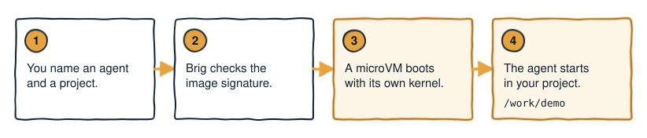

# Quickstart

Run Claude Code in a sandbox on a throwaway project, see one change it makes
to your files, then stop and remove the sandbox.

<p align="center">
  
</p>

## Before you start

- Brig is installed. See [Install Brig](install.md).
- You have an Anthropic account, to log Claude Code in. With no account, use
  the [ubuntu shell](#no-anthropic-account) instead.
- On macOS 14, set these two variables in the terminal you use for every
  step:

  ```bash
  export BRIG_HYPERVISOR=vz BRIG_NETWORK=shared
  ```

  [macOS 14](install.md#macos-14) explains why.
- On Linux, after the default install for the whole machine, run every
  `brig` command as root: `sudo brig doctor`, `sudo brig run ...`. An
  install for one user runs `brig` as that user. See
  [Linux](install.md#linux).

The commands in the steps run in a terminal on your host, unless a step says
otherwise.

## 1. Check the host

```bash
brig doctor
```

Brig prints one line per check. The output is in this shape, and the
versions and paths differ on your host:

```
  ok  brig      v0.5.2 (<commit>, <date>, <go version>, darwin/arm64)
  ok  host      macOS 26.7 on arm64
  ok  virtual   Hypervisor.framework available
  ok  runtime   hull <version> at /opt/homebrew/bin/hull
  --  broker    not started; brig starts /opt/homebrew/bin/brig-broker on the first run with a route
  !!  boot      assets missing at /Users/you/.hull/store/assets
          run any agent once to fetch them, or set BRIG_BOOT_ASSETS to a directory that has them
  ok  rootfs    overlay root available
  ok  verify    cosign at /opt/homebrew/bin/cosign, BRIG_VERIFY=warn
  ok  profiles  9 built in, 0 in /Users/you/.config/brig
  ok  secrets   keychain reachable
  --  brigd     not running (no socket at /Users/you/.brig/brigd.sock)
  --  image     pass an agent to check its image: brig doctor claude
```

`ok` is a pass, `--` is information, and `!!` is a failure with its fix on
the next line. Before the first run, a `!!` on the `boot` line is normal:
the first run fetches the boot assets. Any other `!!` line names its fix.
[Troubleshooting](troubleshooting.md) explains each line.

## 2. Start the agent

```bash
mkdir -p ~/code/demo
brig run claude ~/code/demo
```

`claude` is the default session of the `claude-code` agent. `~/code/demo` is
the project. Brig mounts it read-write at `/work/demo` in the sandbox, and
the agent starts there.

Before the agent starts, Brig prints the notes that apply to this run:

- On a terminal, the first run asks once whether Brig can send anonymous
  usage events. Nothing is sent until you answer. See
  [Telemetry](telemetry.md).
- The first run downloads the guest image and the boot assets, and caches
  them. Later runs start faster.
- A note says that the guest home is temporary, and that `brig rm` deletes
  it.
- When a secret store is available, Brig lists the secrets that the agent
  runs without. These are optional, and the run continues.
- One line says that the signatures verified:

  ```
  brig: image and boot assets verified
  ```

Claude Code then asks you to log in, because the sandbox holds no login.
Follow its prompts inside the sandbox, as on a new machine. For
`claude-code`, Brig keeps this login in memory, so `brig stop` discards it
and the next run asks again. To start logged in every time, see
[Authentication](authentication.md).

## 3. See the change on the host

Type this instruction into Claude Code:

```text
Create hello.txt containing "hello from the sandbox".
```

Exit Claude Code. Then, on the host:

```bash
cat ~/code/demo/hello.txt
```

The file is there. The project is your real directory, not a copy, so
everything the agent writes in `/work/demo` is in `~/code/demo`. The agent
can also change or delete any file there.

The sandbox keeps running after the agent exits. A second
`brig run claude` starts at once, and `brig ls` lists the sandbox:

```
REF          SANDBOX           STATE      WORKSPACE
claude-code  brig-claude-code  running    /Users/you/.brig/homes/brig-claude-code
```

`WORKSPACE` is the guest home: the directory on the host that the sandbox
mounts as the agent's home, for its settings and history.

## 4. Stop and remove

```bash
brig stop claude
```

`brig stop` stops the sandbox. The session, its guest home and the project
stay. The next `brig run claude` boots the sandbox again with the same
project.

```bash
brig rm claude
```

`brig rm` removes the sandbox and deletes the guest home that Brig created,
`~/.brig/homes/brig-claude-code`. It prints the guest home it deleted, and
the project it left:

```
brig:   ↳ the project /Users/you/code/demo stays on the host
```

Neither command touches `~/code/demo`. Delete it yourself when you no longer
need it. [What survives](sessions.md#what-survives) lists what each command
keeps.

## No Anthropic account

`ubuntu` is a root shell with no login. Use it in place of `claude` in each
step:

```bash
brig run ubuntu ~/code/demo
```

The shell starts in `/work/demo`. Type the commands of step 3 at the shell
prompt, inside the sandbox:

```bash
echo "hello from the sandbox" > hello.txt
exit
```

brig-sh does not publish the `ubuntu` image, so Brig cannot verify its
signature. It says so, and boots it:

```
brig: image docker.io/library/ubuntu:latest is not published by brig-sh, so there is no signature of ours to check
brig: boot assets verified
```

Then continue with `cat ~/code/demo/hello.txt`, and with
`brig stop ubuntu` and `brig rm ubuntu`.

## Next steps

- [Authentication](authentication.md): start the agent logged in, or give it
  Git access.
- [Sessions, homes and projects](sessions.md): run several sessions, and keep
  a guest home.
- [Policies](policies.md): restrict what the sandbox can reach.
- [The Brigfile](brigfile.md): write down how a repository runs, and run it
  with `brig run --target`.
- [What Brig protects](security.md): the limits of the sandbox.
